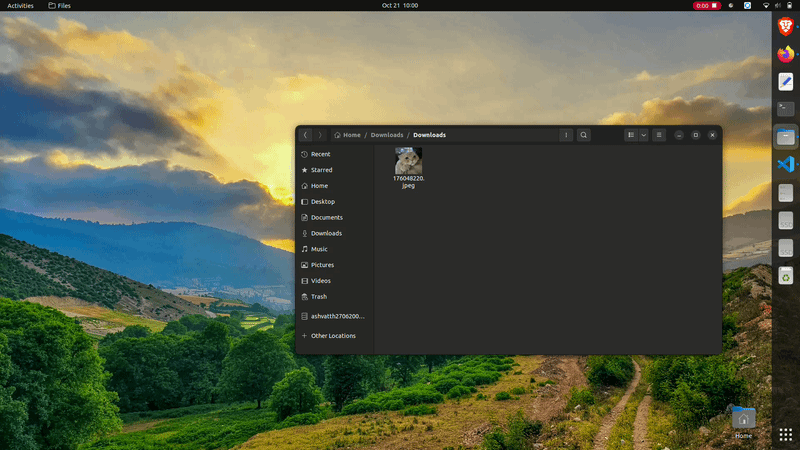

# Rupantar

[](https://github.com/PersuasivePost/rupantar/stargazers)
[](https://github.com/PersuasivePost/rupantar/releases/latest)
[](LICENSE)

**Flick a file toward what you want it to become.** Rupantar is a tray-resident, fully offline file converter: a radial menu at your cursor, one gesture, and the result lands next to the original.

*Transformation of form.* A tray-resident file converter. Press a hotkey (default
`Ctrl/Cmd+Shift+Space`) or drop files on it, and a radial menu opens at your cursor; flick toward an
operation and the converted file is written next to the original.

Everything runs on your machine. There is no telemetry and conversions never touch the network.
The one exception is the optional packs below, which download only after you agree.

## Demo

Word → PDF


JPEG → PNG



## Screenshots

<!-- TODO: add three screenshots under docs/ and uncomment:


-->
*Screenshots coming soon.*

## Roadmap

See [ROADMAP.md](ROADMAP.md) for what's planned.

## Install

> If Rupantar saves you a trip to an online converter, consider giving it a ⭐ on [GitHub](https://github.com/PersuasivePost/rupantar).

Download the installer for your system from the
[Releases](../../releases) page:

| System | File |
| --- | --- |
| Windows (x64) | `.msi` or `-setup.exe` |
| macOS (Apple silicon and Intel) | `.dmg` (universal) |
| Linux (x64) | `.deb`, `.rpm` or `.AppImage` |

Rupantar lives in the system tray (on macOS, the menu bar). Quit it from the tray menu.

### Optional packs

Some operations need a larger component. **They are not bundled with the app**; Rupantar offers to
download one the first time you use an operation that needs it (or under Settings), and shows the
size first. Nothing is downloaded without your agreement.

- **Office pack**: LibreOffice, for DOC/XLS/PPT and Office-quality PDF export.
- **AI pack**: ONNX Runtime, BiRefNet lite and Real-ESRGAN, for Remove background and Upscale.

### Opening an unsigned app on macOS

The macOS builds are **not signed or notarized**, so Gatekeeper blocks the first launch
("Rupantar can't be opened because Apple cannot check it for malicious software"). Either:

- **Right-click (or Control-click) Rupantar in Applications → Open → Open.** You only need to do
  this once. On recent macOS versions, if there is no Open button, try to open it once, then go to
  System Settings → Privacy & Security and click *Open Anyway*.
- or remove the quarantine flag in a terminal:

  ```sh
  xattr -dr com.apple.quarantine /Applications/Rupantar.app
  ```

Signing and notarization need a paid Apple Developer account, which this project doesn't have yet.
Until it does, the steps above are required. Windows installers are unsigned too, so SmartScreen may
warn ("More info" → "Run anyway").

## FAQ

### Why is there a SmartScreen / Gatekeeper warning?

The installers aren't code-signed: signing needs a paid certificate (an Apple Developer account for
macOS, a code-signing certificate for Windows), which this project doesn't have yet. The warning
means "unknown publisher", not "malware found". The code is open and builds in CI; you can also
[build it yourself](#build-from-source).

- **Windows:** SmartScreen → *More info* → *Run anyway*.
- **macOS:** right-click Rupantar → *Open* → *Open*, or see
  [Opening an unsigned app on macOS](#opening-an-unsigned-app-on-macos).

### Why is the dial at the centre of the screen on Wayland?

Wayland doesn't let an app read the cursor position or place its own windows, which is how Rupantar
puts the dial under your cursor. On Wayland it falls back to the centre of the screen. X11, Windows
and macOS position it at the cursor. Under Wayland you can try launching with `GDK_BACKEND=x11`
(XWayland); it may help, but cursor tracking there isn't guaranteed. Global hotkeys can also be
limited on Wayland; the tray menu always works.

### What do the Office and AI packs download, and where do they go?

Nothing is downloaded unless you agree, and the exact size is shown first. Conversions themselves
never use the network.

| Pack | What it is | Downloaded from | Size (Linux x64 / Windows x64) |
| --- | --- | --- | --- |
| Office | The official LibreOffice build, for DOC/XLS/PPT and Office-quality PDF | `download.documentfoundation.org` (archive mirror as a fallback) | ~730 MB / see the dialog |
| AI | ONNX Runtime, BiRefNet lite (background removal), Real-ESRGAN (upscaling) | `github.com`, plus `nuget.org` on Windows | ~280 MB / ~480 MB |

Every file is pinned and checked against a SHA-256 before it is unpacked, and a failed download
resumes where it stopped. Packs live in a `packs` folder inside the app's data directory:

| OS | App data directory |
| --- | --- |
| Windows | `%APPDATA%\app.rupantar` |
| macOS | `~/Library/Application Support/app.rupantar` |
| Linux | `~/.local/share/app.rupantar` |

You can remove a pack in Settings, or delete its folder (`packs/office`, `packs/ai`).

### How do I uninstall Rupantar and remove its data?

Turn off *Start at login* in Settings first, and quit from the tray. Uninstalling never touches
your converted files.

- **Windows:** Settings → Apps → Installed apps → Rupantar → Uninstall (the uninstaller offers to
  delete the application data). To clean up by hand, delete `%APPDATA%\app.rupantar`.
- **macOS:** drag Rupantar from Applications to the Trash, then delete
  `~/Library/Application Support/app.rupantar`.
- **Linux:** `sudo apt remove rupantar` (.deb), `sudo rpm -e rupantar` (.rpm), or delete the
  AppImage; then `rm -rf ~/.local/share/app.rupantar ~/.config/app.rupantar`.

The data directory holds the packs, the log file (`logs/rupantar.log`) and the settings. Nothing
else is written outside the app's own folders.

### Something went wrong. What do I include in a bug report?

Open Settings → About → **Copy debug info** and paste it into the
[bug report](https://github.com/PersuasivePost/rupantar/issues/new?template=bug_report.yml). It is
built on your machine, goes nowhere until you paste it, and contains versions, your OS, tool and
pack status, your hotkey and the last 100 log lines.

## Build from source

You need Rust (1.90 or newer), Node.js 22, and, on Linux, the Tauri system libraries:

```sh
sudo apt-get install libwebkit2gtk-4.1-dev libgtk-3-dev libayatana-appindicator3-dev \
  librsvg2-dev libsoup-3.0-dev libxdo-dev patchelf
```

```sh
npm ci
scripts/fetch-sidecars.sh      # pandoc + typst, as Tauri sidecars (src-tauri/binaries/)
scripts/fetch-pdfium.sh        # pdfium (src-tauri/resources/pdfium/)
npm run tauri dev              # run the desktop app
npm run tauri build            # build the installers into src-tauri/target/release/bundle/
```

Both scripts take a target triple (`scripts/fetch-sidecars.sh aarch64-apple-darwin`) and verify
pinned SHA-256 digests. For a universal macOS build, run `scripts/fetch-universal-macos.sh` and
then `npm run tauri build -- --target universal-apple-darwin`.

Without the desktop shell (no webview libraries needed):

```sh
npm run dev                    # the UI in a browser, with mock operations (port 5000)
npm run build                  # typecheck + bundle the frontend
cargo test -p engine -p placement -p packs
cargo clippy --workspace --all-targets
```

The pandoc/typst/pdfium tests use the files fetched above, and skip when they are missing. See
[CLAUDE.md](CLAUDE.md) for the architecture and the decisions log.

## Releases

CI (`.github/workflows/ci.yml`) runs the tests, clippy and the frontend build on every push.
Pushing a tag such as `v0.1.0` runs `.github/workflows/release.yml`, which builds Windows, macOS
(universal) and Linux installers and attaches them to a **draft** release for you to review and
publish. Bump the version in `src-tauri/tauri.conf.json`, `src-tauri/Cargo.toml` and
`package.json` before tagging.

## License

[MIT](LICENSE). Bundled and downloadable third-party components keep their own licenses; see
Settings → Open-source licenses.
